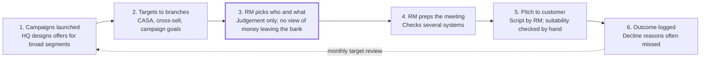

# Discovery: AI Offer Copilot for Relationship Managers

27 Oct 2026, revised 28 Oct 2026 · Bhavini Sapra

## Purpose and method

This discovery uses desk research instead of user interviews, because the project is a solo side project with no access to bank RMs. Every finding is tagged with a confidence level so the strategy doc and PRD know which claims are evidenced and which are assumptions.

**Goal of discovery:** decide whether an AI copilot that helps relationship managers (RMs) pick the right bank campaign for each customer solves a real problem common across banking markets, and what it must get right for any bank to adopt it.

**How markets are used here:** the evidence is sampled from two banking markets, India and Malaysia, chosen because they differ in size, regulation and product mix (Malaysia has a large Islamic banking sector). Where both show the same pattern, we treat it as a general banking pattern. The product itself is market-agnostic: anything local goes into each bank's rule pack.

**Sources used instead of interviews:**

- Regulator publications: RBI (India) and Bank Negara Malaysia (BNM) on AI, conduct and data protection
- Bank and industry disclosures: deposit and CASA trends, Islamic banking share
- Vendor material: what existing next-best-offer products claim to solve
- Public role descriptions of RMs, used as a proxy for their targets and daily work

**Confidence scale:**

| Level | Meaning |
| --- | --- |
| High | Stated directly by a regulator, bank disclosure or multiple credible sources |
| Medium | Supported by one credible source or strongly implied by several |
| Low | Reasoned assumption, no direct evidence yet; listed in the assumption log |

**Limitation stated upfront:** desk research tells us what banks and regulators say, not what RMs feel day to day. User pain points in this doc are therefore hypotheses, not validated findings.

## Market context

Both sample markets show the same core problem: banks are short of cheap deposits and are paying more to attract money. That points to a general banking pattern, so a tool that pulls in external money, without simply moving existing balances into costlier products, is relevant wherever banks compete for deposits. Confidence: **High**.

| Signal | India | Malaysia |
| --- | --- | --- |
| Low-cost deposit share (CASA) | Around 39% in FY2026, down from a 44% peak in FY22 ([Crisil](https://intelligence.crisil.com/en/homepage/what-we-think/all-our-thinking/reports/2026/06/banking-sentimeter.html), [SuperKalam summary of RBI data](https://superkalam.com/current-affairs/05-07-2026/amid-slowing-casa-growth-banks-turn-to-costly-solutions-pg13-08393e5c-8693-4908-ac01-27fd8944c0cb)) | Large banks report CASA declines and are publicly targeting higher CASA ([The Edge, 2023](https://ceomorningbrief.theedgemalaysia.com/article/2023/0629/Home/12/680863), [The Edge, MBSB](https://theedgemalaysia.com/node/714435), [Bernama, UOB Malaysia](https://bernama.com/tv/news.php?id=2329229)) |
| Loans growing faster than deposits | Credit-to-deposit ratio reached 82.5% by mid-June 2026, up from about 75% a year earlier | Banks cite intense deposit competition squeezing margins in a market of around three dozen lenders ([The Edge](https://theedgemalaysia.com/node/714435)) |
| Customers moving to costlier products | CASA falling as customers prefer higher-yield products; banks lean on term deposits ([Crisil](https://intelligence.crisil.com/en/homepage/what-we-think/all-our-thinking/reports/2026/06/banking-sentimeter.html)) | CIMB attributed its CASA decline to customers migrating from CASA to fixed deposits as rates rose ([The Edge](https://ceomorningbrief.theedgemalaysia.com/article/2023/0629/Home/12/680863)) |
| Islamic banking | Not a major factor | Islamic financing reached 48% of total financing in 2025; takaful participation 24.5% ([BNM Annual Report 2025](https://www.bnm.gov.my/publications/ar2025/ch1d)) |

**Why this matters for the product:**

- The CIMB example is direct evidence of the cannibalisation risk: money moving from savings to fixed deposits inside the same bank raises funding cost without adding new money. The scoring engine must penalise this in any market.
- Where loans grow faster than deposits (as in India), campaigns that bring in deposits matter as much as loan cross-sell. Each bank should be able to weight campaign goals in its rule pack.
- Where Islamic banking is large (nearly half of financing in Malaysia), Shariah-compliant offers and wording are core. The product catalogue must support them as a standard option, not an edge case.

**Data gap:** recent Malaysia-wide CASA figures were not found in public sources; the Malaysian evidence comes from individual banks between 2023 and 2026.

## Users

The RM is the primary user, and their job is the same in both sample markets: grow balances, win new customers and cross-sell against monthly targets. Bank job descriptions in India and Malaysia list near-identical goals, which suggests the role is broadly the same across banking markets. Confidence: **High** for goals, **Low** for daily pain points (not directly observed).

**Evidence from public RM role descriptions:**

- India: IDFC FIRST Bank lists CASA build-up against branch targets, more products per customer, and presenting *suitable* products after profiling ([IDFC role](https://www.foundit.in/job/relationship-manager-first-wealth-idfc-mumbai-55424126)). Axis Bank priority RMs carry monthly targets and cross-sell bank and third-party products ([Axis role](https://www.foundit.in/job/branch-relationship-manager-priority-banking-axis-bank-india-60592978)).
- Malaysia: an RHB Premier RM posting lists KPIs including AUM growth, new-to-Premier customers, mortgage and bancassurance cross-sell, and campaign targets ([RHB Premier role](https://www.careers-page.com/elegant-consulting/job/L5W7XXR5)). Alliance Bank's Privilege Banking RMs grow CASA and fixed deposit balances and identify cross-sell opportunities ([Alliance role](https://my.hiredly.com/jobs/jobs-malaysia-alliance-bank-malaysia-berhad-job-associate-customer-relationship-manager-35)). HSBC Malaysia asks for English and Bahasa Malaysia, with Mandarin or Cantonese a plus ([HSBC role](https://apply.careers.hsbc.com/job/Miri-Premier-Relationship-Banker%2C-Miri-13-98000/1370066957/)).

**Proto-personas** (built from desk research, to be validated):

| Persona | Role in the product | What they want | What worries them |
| --- | --- | --- | --- |
| Relationship Manager (primary) | Uses the copilot before and during customer meetings | Hit monthly targets with fewer wasted pitches; know what to say | Pitching the wrong product, losing customer trust, complaints |
| Branch / Premier Centre Manager | Tracks team performance, assigns campaign focus | See which campaigns convert and which RMs need coaching | Team missing targets, uneven performance |
| Campaign / Product Manager | Creates and manages campaigns in the catalogue | Campaigns reach the right customers within budget | Campaigns going to ineligible or uninterested customers |
| Compliance Officer | Sets suitability rules and reviews scripts | No mis-selling, clear disclosures, audit trail | AI recommending unsuitable products, unclear reasoning |
| Customer (indirect) | Receives the pitch | Offers that actually help, not pressure | Being sold something they did not need |

**What varies:** language needs differ by market. Malaysian RMs often serve multilingual customers; Indian RMs need English and Hindi, with regional languages as an option. Talk track languages are therefore a rule pack setting, not built into the core.

## Current process

Campaigns flow from head office to branches to RMs, and the only step that matches a campaign to a specific customer is the RM's own judgement. This journey is inferred from RM job descriptions and vendor material, so treat each step as a hypothesis. Confidence: **Medium** for steps 1 and 2, **Low** for steps 3 to 6.

Step 3 (highlighted) is the gap this product targets. The copilot replaces it with leak detection, suitability filtering and ranking, and supports steps 4 to 6 with prep, the talk track and outcome capture.

## Pain points and problem hypotheses

Three of eight hypotheses are backed by strong public evidence: cannibalisation of cheap deposits, rising mis-selling scrutiny, and the need for Islamic and multilingual handling in Malaysia. The rest describe the RM's daily experience and stay Low or Medium until validated.

| ID | Hypothesis | Evidence | Confidence |
| --- | --- | --- | --- |
| H1 | Campaigns are designed for broad segments; RMs decide manually which one fits each customer | RM KPIs include campaign targets ([RHB Premier role](https://www.careers-page.com/elegant-consulting/job/L5W7XXR5)); a market of next-best-offer vendors exists to fill this gap | Medium |
| H2 | RMs do not have a single view of where a customer's money flows out to other banks | Inferred; no direct source | Low |
| H3 | Targeting by likelihood of acceptance moves money inside the bank (savings to fixed deposits) and raises funding cost | CIMB linked its CASA fall to customers shifting to fixed deposits ([The Edge](https://ceomorningbrief.theedgemalaysia.com/article/2023/0629/Home/12/680863)); India CASA down to ~39% as customers chase yield ([Crisil](https://intelligence.crisil.com/en/homepage/what-we-think/all-our-thinking/reports/2026/06/banking-sentimeter.html)) | High |
| H4 | RMs spend meaningful time preparing for each meeting by checking several systems | Inferred; no direct source | Low |
| H5 | Banks need documented suitability and reasons for every recommendation | RBI's 2026 conduct rules require suitability checks, explicit consent and post-sale feedback ([law.asia](https://law.asia/rbi-mis-selling-and-digital-sales-rules/)) | High |
| H6 | Target pressure pushes RMs toward products that pay them most rather than those that fit | RBI's draft explicitly targeted incentives and sales contests that push products ([Outlook Business](https://www.outlookbusiness.com/economy-and-policy/rbi-proposes-to-end-incentive-structures-at-banks-to-curb-mis-selling)) | Medium |
| H7 | Malaysian RMs must handle conventional and Islamic products and pitch in more than one language | Islamic financing is 48% of total financing ([BNM](https://www.bnm.gov.my/publications/ar2025/ch1d)); HSBC Malaysia RM roles require English and Bahasa Malaysia ([HSBC](https://apply.careers.hsbc.com/job/Miri-Premier-Relationship-Banker%2C-Miri-13-98000/1370066957/)) | High |
| H8 | Banks rarely capture why a customer declined an offer, so campaigns do not improve | Inferred; no direct source | Low |

**Most important tension found:** banks set RM targets and run campaigns, while regulators are cracking down on target-driven pushing. A copilot that only maximises sales would increase regulatory risk. The product must position itself as a *suitability-first* engine that also improves conversion, not the reverse.

## Regulatory context

Regulators in both sample markets now expect AI in banking to be explainable and fair, sales to be suitable and consented, and personal data used only for stated purposes. These requirements become product features, not legal footnotes. Confidence: **High**.

| Area | India | Malaysia | What the product must do |
| --- | --- | --- | --- |
| AI governance | RBI FREE-AI framework, released 13 August 2025, built on seven guiding principles ([law.asia](https://law.asia/rbi-ai-framework/), [Storyboard18](https://www.storyboard18.com/amp/digital/rbi-unveils-free-ai-framework-to-drive-ethical-ai-adoption-in-finance-78934.htm)) | BNM Discussion Paper on AI in the Malaysian Financial Sector, 5 August 2025; consultation closed 17 October 2025 ([BNM](https://www.bnm.gov.my/-/dp-aifs25)) | Explain every recommendation in plain words; keep a log of inputs, outputs and RM actions; human RM always decides |
| Sales conduct and mis-selling | Responsible Business Conduct Second Amendment Directions, 2026, in force 1 January 2027: explicit consent, suitability assessment, no push incentives, feedback within 30 days, no dark patterns ([law.asia](https://law.asia/rbi-mis-selling-and-digital-sales-rules/)) | To verify: BNM expectations on fair treatment and product suitability (not researched in this pass) | Suitability rules block unsuitable offers before scoring; talk track includes disclosures; record customer consent and outcome |
| Data protection | DPDP Rules notified November 2025; full compliance due May 2027 ([TCSA](https://www.tcsa.in/resources/dpdp-rules-2025-implementation-roadmap)) | PDPA amended in 2024, in force in stages during 2025; customers can object to direct marketing ([Baker McKenzie](https://insightplus.bakermckenzie.com/bm/data-technology/malaysia-personal-data-protection-amendment-act-2024-to-come-into-force), [offlist.me summary of JPDP guidance](https://www.offlist.me/what-is-malaysia-pdpa)) | Only score customers with valid marketing consent; respect opt-outs; show data used for each recommendation |

**Design implication:** compliance is a selling point. A bank's compliance team is more likely to approve a copilot that enforces suitability and keeps an audit trail than one that only boosts sales. On its own it is not a differentiator, since major vendors also claim audit trails (see Competitive landscape); it is the price of entry.

**Note on dates:** one source reported the RBI final directions on 15 June 2026; the in-force date of 1 January 2027 comes from law.asia. Confirm against the RBI notification before quoting either date in an interview.

## Competitive landscape

The category is mature: large vendors already recommend next best offers to bankers, score them by propensity and value, and claim suitability and audit trails. Our project cannot claim to be first or uniquely compliant. Its differentiation has to be specific. Confidence: **High** for what vendors claim, **Low** for how well they deliver it.

| Player | What it claims | Overlap with our idea |
| --- | --- | --- |
| [Pega Customer Decision Hub](https://pega.com/node/129241) | Real-time propensity scores per action, ranked by customer need and value to the bank | High: same core scoring logic |
| [Pega Sales Automation for Financial Services](https://pega.com/industries/financial-services/sales-automation) | Suggests suitable offers to banking sales staff, with guided processes and a full audit trail | High: same user (banker) and compliance angle |
| [Personetics](https://martechseries.com/predictive-ai/ai-platforms-machine-learning/personetics-puts-power-ai-hands-bank-relationship-managers-agents-personalized-insights-advice-available-via-salesforce-microsoft-crm/) | AI insights for relationship managers inside Salesforce and Microsoft CRM | Medium: insights, less focus on campaign ranking |
| [Salesforce Financial Services Cloud](https://www.salesforce.com/eu/events/webinars/reinventing-b2b-sales-financial-services/) | AI agents to cut RM prep, research and follow-up work | Medium: RM productivity, broader CRM |
| Bank in-house models | Analytics teams at large banks build their own propensity models | Unknown: not publicly documented |

**Where this project can credibly stand apart:**

1. **Net-new-money objective.** Scoring explicitly penalises money moving inside the bank (for example savings into fixed deposits). Vendors talk about value to the bank, but none of the material reviewed names cannibalisation as a scoring input.
2. **Leakage signals from local payment rails.** Recurring outflows to other institutions are read as clues to competitor-held loans, cards and accounts. In the sample markets these run on rails such as NACH, UPI Autopay and BBPS (India) and DuitNow AutoDebit, FPX Direct Debit and JomPAY (Malaysia); each bank names its own in the rule pack.
3. **Rule packs, including Shariah-compliant products.** One engine for any market, with local rules, products and wording handled by configuration.
4. **Grounded talk tracks.** The language model writes only from campaign facts and must include required disclosures.

**Honest limit:** points 1 and 2 are based on the vendor material reviewed, not a full product audit. In an interview, frame them as *design choices*, not claims that competitors lack them.

## From sample markets to a rule pack

The two sample markets differ in every local detail but need the same *types* of settings. That is the case for one market-agnostic core: each requirement type becomes a rule pack setting that a bank fills in.

| Requirement type | Seen in India | Seen in Malaysia | Rule pack setting |
| --- | --- | --- | --- |
| Payment types for leak detection | NACH, UPI Autopay, BBPS | DuitNow AutoDebit, FPX Direct Debit, JomPAY | Which recurring and bill payment types count as money leaving |
| Credit and eligibility | Credit bureaus (for example CIBIL) | CCRIS, CTOS | Credit bands and eligibility rules per product |
| Sales conduct and suitability | RBI conduct rules | BNM expectations (to verify) | Risk-profile bands, hard blocks, warnings, disclosures |
| Investment licensing | SEBI; AMFI-registered distributors | Securities Commission; FIMM-registered consultants | Licence needed per product type |
| Data and consent | DPDP Act and Rules | PDPA (amended 2024) | Consent and opt-out rules |
| AI governance | RBI FREE-AI framework | BNM AI discussion paper | Explainability and audit requirements |
| Products | Mostly conventional | Conventional and Islamic | Catalogue with optional Shariah-compliant variants |
| Languages | English, Hindi | English, Bahasa Malaysia | Talk track languages |
| Currency | INR | MYR | Currency and formats |

## Assumption log

The riskiest assumptions are about the RM's daily experience (H2, H4, H8), because no public source covers them. Each can be checked cheaply without formal interviews.

| Assumption | Risk if wrong | Low-effort validation |
| --- | --- | --- |
| RMs lack a single view of outflows to other banks (H2) | Leak detection adds less value than expected | Read RM posts and comments on LinkedIn and banking forums; check if bank apps already show this |
| Meeting prep takes meaningful RM time (H4) | Copilot saves less time than claimed | Watch public "day in the life of a bank RM" videos; vendor material already cites RM prep burden ([Salesforce](https://www.salesforce.com/eu/events/webinars/reinventing-b2b-sales-financial-services/)) |
| Decline reasons are rarely captured (H8) | Feedback loop is not a differentiator | Look for this field in public CRM demos and vendor documentation |
| RMs would trust and use AI reasons | Low adoption even if accurate | Post the prototype on LinkedIn and ask bankers for async feedback through a short form |
| Leak signals can be detected from transaction descriptions | Core feature is not feasible with real data | Review sample bank statement formats from both sample markets (for example how NACH and DuitNow debits are labelled) |
| Priority/premier segment is the right first segment | Wrong focus for v1 | Compare RM coverage in public bank disclosures |

- [ ] Validate H2 through public RM posts and forums
- [ ] Validate H4 through public day-in-the-life content
- [ ] Check statement formats for leak-signal feasibility
- [ ] Collect async feedback on the prototype from bankers

## Problem statement and opportunity

**Problem statement (draft):** Relationship managers in priority banking must hit deposit, cross-sell and campaign targets, but they choose which campaign to pitch each customer largely by judgement. This leads to offers that move money within the bank instead of bringing new money in, and to rising mis-selling risk as regulators tighten suitability and consent rules.

**Opportunity:** a copilot that, for each customer, detects money flowing to other institutions, filters campaigns by eligibility and suitability, ranks the remaining ones by net new money, and gives the RM a grounded, compliant talk track.

**How we will know it works (to refine in the PRD):**

- Share of recommendations that target external money rather than internal movement
- Offer acceptance rate per recommendation
- Zero recommendations that fail a suitability rule
- RM prep time per meeting

**Out of scope for v1:** mass-retail customers without an RM, digital self-service channels, and real bank data integration.

