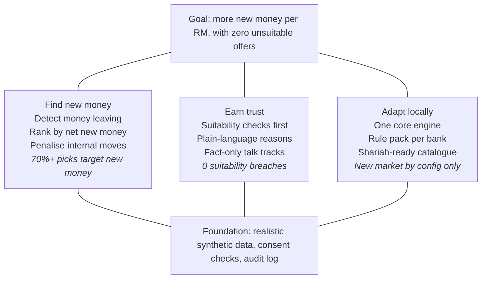
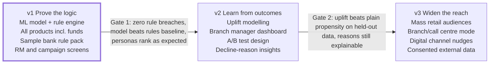

# Strategy: AI Offer Copilot for Relationship Managers

27 Oct 2026, revised 28 Oct 2026 · Bhavini Sapra · Status: draft

## Strategy in brief

We will build an RM copilot for priority and premier banking that wins on one idea vendors do not lead with: **rank offers by net new money to the bank, not by likelihood of a yes.** Suitability rules run first, every recommendation explains itself, and talk tracks are grounded in campaign facts. The product is market-agnostic: one core engine, plus a **rule pack** each bank configures with its own regulations, compliance requirements, products, payment rails and languages. Version 1 uses three layers of AI working together: a machine learning model predicts how likely each customer is to accept each offer, transparent rules decide what is eligible and suitable, and a language model writes the talk track. Every product family is in scope from day one, investments included.

This strategy builds on the [discovery findings](01-discovery.md). Where a choice rests on a Low-confidence assumption from discovery, it is marked.

## Vision and mission

**Vision:** every conversation between a banker and a customer leaves the customer better off and brings the bank money it did not already have.

**Mission (next 12 months):** give relationship managers in any bank a copilot that tells them which campaign to raise with each customer, why it fits, and how to say it, without ever recommending something unsuitable.

## Where we play

We start where an RM already sits in front of the customer: priority and premier banking. Mass retail customers have no dedicated RM and bring less revenue each, so they come in the widen-the-reach phase (v3).

| Dimension | Choice for v1 | Why |
| --- | --- | --- |
| Segment | Priority / premier retail customers with an assigned RM | RMs carry deposit, cross-sell and campaign targets (discovery: Users) |
| Primary user | Relationship Manager | Makes the pitch and the final call |
| Secondary users | Campaign manager, branch or premier centre manager, compliance officer | Create campaigns, track results, set suitability rules |
| Buyer | Head of retail or priority banking, with compliance sign-off | Owns deposit and cross-sell targets; compliance can block adoption |
| Markets | Any; no market is hard-coded | Deposit pressure and the RM role are common across banking markets; local differences live in the rule pack |
| Product families | Deposits, cards, home loans, personal loans, insurance and investments, with optional Shariah-compliant variants | Standard retail banking range |
| Delivery model | A product a bank configures, not a custom build | One engine; each bank adds its own rules and compliance |
| Demo setting | A fictional sample bank with a sample rule pack | Keeps the demo concrete without tying it to one country |

**Confidence note:** choosing priority banking first rests on a Low-confidence assumption from discovery (RM coverage). It is the obvious starting point, but we have not checked RM coverage in public bank disclosures yet.

## Positioning

**Statement:** For relationship managers in priority banking who must grow deposits and cross-sell without mis-selling, the RM Offer Copilot recommends which campaign to raise with each customer. Unlike general next-best-offer platforms that rank by likelihood of acceptance and value, it ranks by **net new money**, detects money already leaving for competitors, and adapts to any bank's regulations, compliance rules and product range, including Shariah-compliant variants, through configuration.

| Our choice | Typical alternative | Why ours |
| --- | --- | --- |
| Rank by new money from outside, minus cannibalisation | Rank by propensity x value | Moving savings into fixed deposits looks like a win but raises the bank's funding cost (discovery: H3) |
| Start from money leaving the bank | Start from products the customer lacks | A leak is concrete evidence of need and an existing competitor relationship to win |
| Suitability filter before scoring | Suitability as a check after ranking | An unsuitable offer never reaches the RM, which compliance can approve |
| Talk track written only from campaign facts | Free-form AI suggestions | No invented rates or features; disclosures always present |
| A rule pack each bank configures | Custom build per bank or country | One engine for any market; the bank adds its own rules and compliance |

These are **design choices**, not claims that competitors cannot do them (discovery: Competitive landscape).

## Strategic pillars

Every feature must serve one of three pillars, and all three rest on the same foundation. A feature that serves none of them is out of scope.

The metric under each pillar comes from the guardrails and input metrics in Goals and metrics.

## Goals and metrics

The North Star measures what the bank actually wants: new money, not clicks or acceptance. Guardrails carry equal weight, because a copilot that grows sales by breaking a suitability rule has failed.

**North Star metric:** net new money influenced per active RM per month. Definition: external balances, refinanced loans and new card relationships won through accepted recommendations, minus balances that only moved between the bank's own products.

| Type | Metric | v1 target (on synthetic data) |
| --- | --- | --- |
| Input | Share of top recommendations that target external money | At least 70% |
| Input | Customers with at least one detected leak signal that receive a relevant offer | At least 90% |
| Model | Acceptance model accuracy on held-out data (AUC) | Beats the rules-only baseline |
| Model | Recommendations with model-based reason codes | 100% |
| Input | RM steps from opening a customer to having a talk track | 3 clicks or fewer |
| Guardrail | Recommendations that fail a suitability or eligibility rule | 0 |
| Guardrail | Investment offers above the customer's assessed risk profile | 0 |
| Guardrail | Talk tracks containing a figure not in the campaign data | 0 |
| Guardrail | Customers without marketing consent who are scored | 0 |
| Guardrail | Recommendations without a plain-language reason | 0 |

**Honest limit:** with synthetic data, the North Star and acceptance rate are simulated. The case study must say so. What the demo can genuinely prove is that the engine behaves correctly: it prefers external money, blocks unsuitable offers and never invents facts. The targets above are design targets for that demo, not forecasts of real bank results.

## Phasing

Version 1 is the whole portfolio project. Versions 2 and 3 show where the product would go and are documented, not built, unless time allows.

A phase starts only when the gate before it is met. "Consented external data" in v3 means open-banking or account-aggregation data, in markets where such systems exist and the customer has agreed to share it.

## Non-goals

Saying no protects the timeline and keeps the demo credible.

- **No mass retail before v3.** Premium customers first. Mass retail joins in v3 through an audience builder for campaign managers and a branch and call centre mode.
- **No real customer data and no bank integrations.** Synthetic data only.
- **No regulated activity.** The copilot supports bank staff; it does not sell, advise customers directly or need a licence. Approvals and licences stay with the bank.
- **No automated selling.** The copilot never contacts a customer; the RM decides and acts.
- **No new product design.** The engine chooses from existing campaigns; it does not invent offers.
- **No model overriding the rules.** The ML model ranks only offers the rules have already allowed; it can never bring back an unsuitable one.
- **No black-box ranking.** If a model's prediction cannot be explained in plain words, it is not shown.
- **No market hard-coded in the core.** Anything local lives in the rule pack.

## Key bets and risks

The biggest risk is not technical. It is that the demo looks fake or reads like a sales-push tool. Both are addressed by design choices made now.

| Risk | Likelihood | Impact | Mitigation |
| --- | --- | --- | --- |
| Synthetic data looks unrealistic, so the demo is not convincing | High | High | Build a rules-based generator with salary cycles, loan instalments, card payments and seasonal spending; publish its assumptions |
| The ML model just learns back the rules used to generate the data | High | High | Generate customer responses from a hidden pattern plus randomness; compare the model against a rules-only baseline; say openly what the model can and cannot prove |
| Investment products bring licensing and stricter suitability rules in most markets | High | High | Risk-profile match as a hard rule; a licence check the bank configures for each RM; disclosures in every investment talk track |
| A generic design misses a real regulatory requirement | Medium | High | The rule pack covers the requirement types common across markets: suitability, consent, disclosures, licensing and audit (drawn from discovery evidence) |
| Staying market-agnostic makes the demo feel abstract | Medium | Medium | Use a realistic fictional sample bank, with a second sample rule pack to show how configuration changes behaviour |
| Leak signals may not be readable from real transaction labels (discovery: Low confidence) | Medium | High | Design leak detection around labelled payment types the rule pack defines; state the assumption openly in the case study |
| AI talk track invents a rate or feature | Medium | High | Pass only structured campaign facts; automatically check every number in the output against the campaign |
| Product reads as a sales-pushing tool | Medium | High | Lead every screen and the case study with suitability and reasons, not conversion |
| "Pega already does this" in interviews | High | Medium | Frame differentiators as design choices and explain the net-new-money logic in depth |

## Portfolio goals

This is a career project, so it has a second customer: a BFSI hiring manager. The product succeeds as a portfolio piece only if it proves four things.

| What it must prove | Evidence in the project |
| --- | --- |
| BFSI domain fluency | Cost of funds and CASA logic in scoring; suitability and licensing rules; Shariah-compliant variants; consent and audit handled as features |
| Product management craft | Discovery, strategy, PRD, UX, tech design, build plan and launch write-up, all public in the repo |
| AI product judgement | Grounded talk tracks, explainable rankings, automated fact checks, honest limits |
| Ability to ship | A live demo of the sample bank, with a second rule pack switchable to show configurability |

**Done means:** a public repo, a working demo, a 2-minute walkthrough video, a case study page, and the ability to explain any design choice in an interview without notes.

## Open decisions for the PRD

- [ ] Acceptance model: algorithm, features and how reason codes are produced
- [ ] How synthetic customer responses are generated so the model has a real pattern to learn
- [ ] The exact cannibalisation formula: which internal moves are penalised and by how much
- [ ] Investment suitability: standard risk-profile bands and how product risk is rated
- [ ] Rule pack structure: which settings a bank configures and in what format
- [ ] Number of campaign templates in the sample catalogue (proposed: 15 to 18, including investments)
- [ ] Talk track languages in v1: English only, or English plus one more to prove multilingual support
- [ ] Whether the branch manager dashboard is in v1 or v2
- [ ] Which suitability rules are hard blocks and which are warnings
- [ ] UI stack and language model provider (decided in the tech design)
