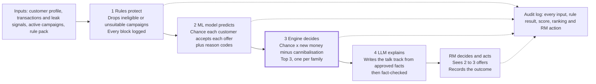

# PRD: AI Offer Copilot for Relationship Managers (v1)

28 Oct 2026 · Bhavini Sapra · Status: draft

## Overview

Version 1 is a working copilot for relationship managers (RMs) serving premium customers at a fictional sample bank. For each customer it shows the 2 to 3 best campaigns, why they fit, and what to say, ranked by **net new money** to the bank and never including an unsuitable offer. A campaign manager can create and manage the campaigns it chooses from, and a compliance officer can see the rules and an audit trail of every recommendation.

**One-line summary of how it works:** the rules protect, the ML model predicts, the decision engine decides, and the language model explains.

**Built on:** [discovery](01-discovery.md) and [strategy](02-strategy.md).

**Status:** draft. Decisions this PRD makes on the strategy's open questions are tagged **[Decision]** and listed again in *Decisions made and open questions*, so each can be overruled in one place.

## Scope

Version 1 covers premium customers end to end: synthetic data, leak detection, rules, an ML acceptance model, the decision engine, talk tracks, and screens for three users. Everything customer-facing or mass-scale waits for later versions.

| In v1 | Not in v1 (version) |
| --- | --- |
| Premium customers with an assigned RM | Mass retail audiences, branch and call centre mode (v3) |
| All product families: deposits, cards, home loans, personal loans, insurance, investments | Products outside retail banking, such as business banking |
| Synthetic data for a fictional sample bank, plus a second sample rule pack | Real customer data or bank system integrations (never in this project) |
| ML acceptance model with reason codes, against a rules-only baseline | Uplift modelling (v2) |
| Screens for RM, campaign manager and compliance officer | Branch manager dashboard (v2) |
| Talk tracks in English | Further talk track languages (v2) **[Decision]** |
| Outcome capture and audit log | Learning automatically from captured outcomes (v2) |
| Copilot recommends to bank staff only | Any contact with customers, or digital nudges (v3) |

## Users and user stories

Three users in v1. The RM is primary; the campaign manager feeds the catalogue; the compliance officer must be able to trust and inspect every recommendation. Priority uses **Must** (v1 fails without it) and **Should** (v1 is weaker without it).

**Relationship Manager**

| ID | Story | Priority |
| --- | --- | --- |
| RM-1 | As an RM, I want a daily list of my customers sorted by opportunity, so I know whom to contact first | Must |
| RM-2 | As an RM, I want to see the top 2 to 3 offers for a customer with a plain reason for each, so I can judge them quickly | Must |
| RM-3 | As an RM, I want to see where the customer's money is going to other institutions, so I understand the opportunity | Must |
| RM-4 | As an RM, I want a ready talk track with required disclosures, so I can pitch confidently and correctly | Must |
| RM-5 | As an RM, I want to know which offers were blocked and why, so I don't pitch them by mistake | Should |
| RM-6 | As an RM, I want to record the outcome and the customer's reason in a few taps, so the bank learns what works | Must |
| RM-7 | As an RM, I want to be told when an offer needs a licence I don't hold, so I can refer the customer to a colleague | Must |

**Campaign Manager**

| ID | Story | Priority |
| --- | --- | --- |
| CM-1 | As a campaign manager, I want to create, edit, pause and end campaigns without code, so the catalogue stays current | Must |
| CM-2 | As a campaign manager, I want to set each campaign's goal, eligibility, benefits, dates, cap and disclosures | Must |
| CM-3 | As a campaign manager, I want to see how many customers each campaign is recommended to and accepted by | Should |

**Compliance Officer**

| ID | Story | Priority |
| --- | --- | --- |
| CO-1 | As a compliance officer, I want to view the active rule pack, so I know which rules the engine applies | Must |
| CO-2 | As a compliance officer, I want an audit log of every recommendation, its inputs, reasons and RM action | Must |
| CO-3 | As a compliance officer, I want to see every talk track that failed the fact check, so I can confirm none reached an RM | Should |

## How a recommendation is made

Four stages, each with one job. The rules protect, the ML model predicts, the decision engine decides, and the language model explains. Splitting the work this way makes every recommendation traceable, which regulators expect and an all-in-one model cannot offer.

The RM always makes the final call. The sections below specify each stage, starting with the data that feeds them.

## Synthetic data and response generator

The demo is only as convincing as its data, and the ML model is only honest if customer responses follow a pattern the model has to discover rather than copy. The generator therefore produces customers, transactions and a past campaign history, with responses drawn from a hidden pattern that the model never sees.

| ID | Requirement | Priority |
| --- | --- | --- |
| DATA-1 | Generate about 5,000 premium customers per rule pack: age, income band, occupation type, tenure, products held and balances, credit band, risk profile and the date it was assessed, marketing consent, vulnerability flag, product variant preference (conventional or Shariah-compliant), preferred language, assigned RM | Must |
| DATA-2 | Generate 12 months of transactions per customer: salary credits, recurring debits (loan instalments, insurance premiums, investment debits) to this bank or other institutions, card bill payments, transfers to the customer's own accounts elsewhere, everyday spending with seasonal peaks. Each payment carries a payment type defined in the rule pack | Must |
| DATA-3 | Record each customer's true external relationships (for example a home loan at another bank) as ground truth, kept apart from the transactions, so leak detection can be measured | Must |
| DATA-4 | Generate about 25 RMs with around 200 customers each; some RMs lack the licence for investment products | Must |
| DATA-5 | Generate 12 months of past campaign exposures and outcomes (accepted or not within 30 days) to train the acceptance model | Must |
| DATA-6 | Draw each past outcome from a hidden response function: observable drivers (leak match, size of benefit, product gap, life stage, engagement) plus unobserved traits (price sensitivity, loyalty to current provider) plus random noise. The function is stored separately and never shown to the model. Eligibility rules are not part of it | Must |
| DATA-7 | Use a fixed random seed and configurable sizes, so every run is reproducible | Must |
| DATA-8 | Publish the generator's assumptions in the repo in plain language | Must |
| DATA-9 | Run sanity checks after generation: income against balances, instalments against loan sizes, share of customers with each leak type | Should |

**Why DATA-6 matters:** if outcomes followed only the visible drivers, the model would simply learn our formula back and look perfect. Unobserved traits and noise make the task realistic: the model can do better than simple rules, but never perfectly.

## Leak detection

A leak is a recurring flow of the customer's money to another institution. Each leak points to a relationship a competitor holds and that the bank could win back.

| ID | Requirement | Priority |
| --- | --- | --- |
| LEAK-1 | Flag a recurring outflow when the same counterparty receives a similar amount at a regular interval at least 3 times in 6 months, and the payment type (from the rule pack) shows it leaves the bank | Must |
| LEAK-2 | Classify each leak into one of the types below | Must |
| LEAK-3 | Store per leak: type, average monthly amount, counterparty category, first and last date seen, confidence (High, Medium, Low) | Must |
| LEAK-4 | Measure detection against the generator's ground truth: precision at least 90%, recall at least 80% **[Decision]** | Must |
| LEAK-5 | Show leaks to the RM in plain words, for example "About 3,800 a month goes to another lender, likely a home loan" | Must |

| Leak type | What it suggests | Campaign families it unlocks |
| --- | --- | --- |
| External loan instalment | A loan held elsewhere | Home loan or personal loan balance transfer |
| External card bill payment | A credit card held elsewhere | Card switch |
| External insurance premium | Cover held elsewhere | Insurance review (never a replacement without a needs check) |
| External investment debit | Regular investing elsewhere | Investment plans, subject to suitability |
| Transfer to own account elsewhere | Savings parked at another bank | Deposits that bring new money in |
| Salary split | Only part of the salary arrives here | Salary account switch |

**Amounts in examples are illustrative.** The sample bank uses a neutral currency set in the rule pack.

## Campaign catalogue

The engine only ever chooses from campaigns that exist in the catalogue. Each campaign carries everything the rules, the decision engine and the talk track need, so no part of the system has to guess.

**Fields per campaign**

| Field | Used by | Example |
| --- | --- | --- |
| Name, product family, product variant (conventional or Shariah-compliant) | All | Home Loan Balance Transfer, home loan, conventional |
| Goal tag: new money, new revenue or retention | Decision engine | New money |
| Target segment and eligibility (age, credit band, holdings, required leak type) | Rules | Age 25 to 60, credit band B or better, external loan instalment present |
| Product risk rating (investments and insurance) | Rules | 3 of 5 |
| Benefits, as structured facts | Talk track, customer benefit | Rate 0.4% below current lender, no processing fee |
| Customer-level values and their limits | Decision engine | Loan amount 50,000 to 1,000,000 |
| Start date, end date, volume cap | Rules | 1 Oct to 31 Dec, 500 customers |
| Suitability notes and mandatory disclosures | Rules, talk track | Early repayment charges at the current lender may apply |
| Licence required | Rules | Investment licence |

**Sample catalogue [Decision]:** 16 campaigns across the product families. Deposits 3 (new-money term deposit, salary account switch, savings booster), cards 3, home loans 2 (balance transfer, top-up), personal loans 2, insurance 3 (life, health, home), investments 3 (low-risk fund, balanced fund, regular investment plan). Sample Bank B adds Shariah-compliant variants of each where they exist.

| ID | Requirement | Priority |
| --- | --- | --- |
| CAT-1 | Campaign manager can create, edit, pause, resume and end a campaign without code | Must |
| CAT-2 | Validate on save: end date after start date, cap above zero, goal tag set, at least one disclosure for regulated products, risk rating set for investments and insurance | Must |
| CAT-3 | A paused or ended campaign stops appearing in recommendations at the next refresh | Must |
| CAT-4 | Every change is recorded in the audit log with who changed what and when | Must |
| CAT-5 | Show per campaign: times recommended, times pitched, accepted, declined | Should |

## Eligibility and suitability rules

Rules run before the model and cannot be overridden by it. A **hard block** removes the offer; a **warning** keeps it but makes the RM see and acknowledge the concern. Every rule result is logged with its rule ID.

Rules run in this order, so the cheapest and most absolute checks come first:

| Order | Rule | Type | Effect |
| --- | --- | --- | --- |
| 1 | No marketing consent | Hard block | Customer is not scored at all; RM sees "Marketing consent not given" |
| 2 | Campaign not active, or volume cap reached | Hard block | Campaign removed for everyone |
| 3 | Outside campaign eligibility (age, credit band, required holdings or leak type) | Hard block | Offer removed |
| 4 | Customer already holds the product (unless it is an upgrade campaign) | Hard block | Offer removed |
| 5 | Customer prefers Shariah-compliant products and the offer is conventional | Hard block | Offer removed; a matching variant is used if one exists |
| 6 | Product risk above the customer's risk profile | Hard block | Investment or insurance offer removed |
| 7 | Risk profile older than the rule pack's validity period (default 24 months) **[Decision]** | Hard block | All investment offers removed; RM sees "Risk profile needs updating" |
| 8 | Vulnerable customer flag | Hard block for investments; warning for others **[Decision]** | Investments removed; other offers need the RM to confirm extra care |
| 9 | Debt service ratio after the new credit above the rule pack limit | Hard block | Credit offer removed |
| 10 | Debt service ratio within 10% of the limit | Warning | RM sees an affordability warning |
| 11 | Same campaign declined within the cooling-off period (default 30 days) | Hard block | Offer removed |
| 12 | Investment would exceed the rule pack's concentration limit of the customer's liquid assets | Warning | RM sees a concentration warning |
| 13 | RM does not hold the licence the campaign requires | Referral | Offer stays, marked "Refer to a licensed colleague"; the RM cannot see its talk track |

**Risk profile bands [Decision]:** five bands (Conservative, Moderately conservative, Balanced, Moderately aggressive, Aggressive) matched against product risk ratings 1 to 5. A product is suitable only when its rating is at or below the customer's band number. Banks can rename or change bands in the rule pack.

| ID | Requirement | Priority |
| --- | --- | --- |
| RULE-1 | Apply rules in the order above and stop evaluating an offer at its first hard block | Must |
| RULE-2 | Load every limit, period and band from the rule pack; none are hard-coded | Must |
| RULE-3 | Show the RM blocked offers and the rule that blocked each, in a collapsed panel | Should |
| RULE-4 | Never pass a blocked offer to the model, the decision engine or the language model | Must |

## Acceptance model

The model answers one question: for this customer and this offer, how likely is a yes within 30 days? It does not choose offers; the decision engine does. It must beat a simple rules-only baseline and explain every prediction in plain words.

| Aspect | Choice |
| --- | --- |
| Unit of prediction | One customer and one campaign at one point in time |
| Label | Accepted within 30 days of the offer being made |
| Algorithm **[Decision]** | Gradient-boosted decision trees (LightGBM): strong on tabular banking data, fast, and explainable with SHAP |
| One model or many | One model for all campaigns, with campaign attributes as features, so a new campaign gets scores from day one |
| Training data | The generator's 12-month campaign history (DATA-5) |
| Split | By time: first 9 months to train, last 3 months to test, so the model is judged on the future, not on shuffled past data |
| Calibration | Probabilities calibrated on held-out data, because the decision engine multiplies them by money |
| Baseline | A rules-only score: points for a matching leak and for a product the customer lacks |
| Success measures | AUC and top-3 hit rate (was the accepted offer among the top 3?) both above the baseline; calibration checked with a reliability plot |

**Features**

| Group | Examples |
| --- | --- |
| Customer | Age band, income band, tenure, number of products held, balance trend, engagement with the bank |
| Leak | Matching leak type, monthly amount, months seen |
| Offer | Product family, size of benefit (for example rate advantage), fee waiver |
| History | Past offers seen, past declines, months since last new product |
| Context | Month of year (seasonality) |

**Never used as features:** gender, religion, ethnicity or any proxy for them. The product variant preference is used only by the rules to filter the catalogue, never by the model, because it can act as a proxy for religion.

| ID | Requirement | Priority |
| --- | --- | --- |
| ML-1 | Train, calibrate and evaluate as above; save the model with a version number | Must |
| ML-2 | Produce reason codes for each prediction: the top 3 drivers by SHAP value, each mapped to a plain-language template. A driver without a template is never shown as a reason | Must |
| ML-3 | Compare against the baseline on the test months and publish the results | Must |
| ML-4 | Check scores across age and income bands for gaps the features do not explain, and document the findings | Must |
| ML-5 | Publish a model card in the repo: purpose, data, features, results, limits | Must |
| ML-6 | Score only offers that passed the rules (RULE-4) | Must |

**Honest limit:** the model learns a pattern we designed (DATA-6). It proves the pipeline works and that the model can find a signal simple rules miss. It does not prove how real customers behave. The model card says so.

## Decision engine

The decision engine turns predictions into a choice. It ranks each offer by the money it is expected to bring in from outside the bank over a year, after subtracting what the bank loses when money only moves between its own products.

**Formula**

> Expected value = chance of acceptance x (external value - cannibalisation cost) x goal weight

| Term | How it is calculated | Source |
| --- | --- | --- |
| Chance of acceptance | Calibrated model output | Acceptance model |
| External value | New money from outside x annual value rate for the product family | Amount from the leak signal or campaign defaults; rate from the rule pack |
| Cannibalisation cost | Money moved from another product at this bank x the difference in annual cost to the bank | Customer holdings; cost rates from the rule pack |
| Goal weight | Multiplier the bank sets per goal tag (for example favour deposits when deposits are short) | Rule pack, default 1.0 |

**Annual value rate by family [Decision]:** deposits use the funding spread the bank earns on new deposits; loans use net interest margin; cards use expected annual spend x interchange plus fees; insurance and investments use commission or fee rate. All rates are rule pack settings, so each bank uses its own economics.

**Worked example (illustrative figures, neutral currency)**

| Offer | Chance | External value | Cannibalisation | Expected value | Result |
| --- | --- | --- | --- | --- | --- |
| Home loan balance transfer: 400,000 moved from another lender at 1.0% margin | 25% | 4,000 | 0 | 1,000 | Rank 1 |
| Card switch: 60,000 spend a year at 1.5% interchange | 40% | 900 | 0 | 360 | Rank 2 |
| Balanced fund: 50,000 a year now invested with another provider, at 1.0% fee | 15% | 500 | 0 | 75 | Rank 3 |
| Term deposit promo: 100,000 moved from the customer's savings here, costing the bank 2.5% more | 70% | 0 | 2,500 | -1,750 | Dropped |

The term deposit has the highest chance of a yes, so an acceptance-only system would put it first. Here it drops out because it brings in nothing new and raises the bank's cost of funds. For a customer who keeps savings at another bank, the same campaign scores positive, because that money would be new. The same logic applies to investments: a fund bought with savings already at the bank carries a cannibalisation cost (the funding spread the bank loses), while a fund that brings in money now invested elsewhere does not.

| ID | Requirement | Priority |
| --- | --- | --- |
| DEC-1 | Compute expected value per offer using the formula and rule pack rates | Must |
| DEC-2 | Drop any offer with expected value of zero or less | Must |
| DEC-3 | Show at most 3 offers, at most 1 per product family; never pad the list with weak offers | Must |
| DEC-4 | When no offer qualifies, show "No suitable offer today" with the main reasons | Must |
| DEC-5 | Rank the RM's daily customer list by the total expected value of each customer's offers | Must |
| DEC-6 | Record every term of the formula per offer in the audit log | Must |

## Explanations and talk tracks

The RM sees two kinds of text: short reasons, built by the system from facts, and a talk track, written by a language model from the same facts and then checked. The language model never decides anything and never adds a fact.

**Reasons** combine the leak signal, the model's top reason codes and the customer benefit, for example: "Pays about 3,800 a month to another lender; our rate is 0.4% lower; has not added a product in 2 years." Customer benefit figures (such as estimated savings) are calculated by code, not by the language model.

**Talk track structure**

1. Opening that asks permission to discuss the topic
2. Why this fits the customer, using only the reasons above
3. Offer details from the campaign facts
4. Two likely objections with honest responses
5. Mandatory disclosures, inserted word for word from the rule pack
6. A closing question that leaves the decision with the customer

| ID | Requirement | Priority |
| --- | --- | --- |
| TT-1 | Send the language model only a structured set of approved facts: campaign facts, reasons, customer benefit, tone rules | Must |
| TT-2 | After generation, check that every number, rate, fee and product name in the text appears in the approved facts | Must |
| TT-3 | If the check fails, regenerate once; if it fails again, show a template-based talk track and log the failure | Must |
| TT-4 | Insert disclosures from the rule pack verbatim; the language model does not write them | Must |
| TT-5 | Block phrases the rule pack bans (for example "guaranteed returns") | Must |
| TT-6 | For Shariah-compliant products, apply the rule pack's terms (for example "profit rate", never "interest") | Must |
| TT-7 | Write talk tracks in English in v1; the language is a rule pack setting so more can be added **[Decision]** | Must |
| TT-8 | Generate on demand when the RM opens an offer, and reuse it for the same customer and offer on the same day | Should |

## Screens and user flows

Ten screens across three roles. Detailed layouts come in the UX phase; this section fixes what each screen must contain. The RM's core flow is: daily list, customer, offer and talk track, outcome.

| ID | Screen | Role | Must contain |
| --- | --- | --- | --- |
| S1 | My customers today | RM | Customers ranked by opportunity; per row: name, top offer, number of leak signals, last contact date, any warning |
| S2 | Customer view | RM | Profile summary; leak signals in plain words; top 2 to 3 offer cards with reasons; collapsed panel of blocked offers and why; "No suitable offer today" state |
| S3 | Offer and talk track | RM | Talk track; disclosures as a checklist; warnings to acknowledge; copy button; referral note when the RM lacks the licence |
| S4 | Record outcome | RM | Accepted, declined, follow up (with date) or not pitched; reason picklist; optional note |
| S5 | Campaigns | Campaign manager | List with status, dates, cap used, recommended, pitched, accepted |
| S6 | Campaign editor | Campaign manager | All catalogue fields with validation (CAT-2) |
| S7 | Rule pack | Compliance officer | Read-only view of every active rule, limit and disclosure, with the pack version |
| S8 | Audit log | Compliance officer | Search by customer, RM, campaign or date; open any recommendation to see every input and decision |
| S9 | Fact-check failures | Compliance officer | Every talk track that failed the check, what failed, and what the RM saw instead |
| S10 | Demo controls | All | Switch role and switch between Sample Bank A and B (demo only; no real sign-in) |

| ID | Requirement | Priority |
| --- | --- | --- |
| UX-1 | An RM reaches a talk track from the daily list in 3 clicks or fewer | Must |
| UX-2 | Each offer's reason is visible without expanding anything | Must |
| UX-3 | Outcome cannot be recorded as "pitched" until all disclosures are ticked | Must |
| UX-4 | Every screen works at tablet width, since RMs often meet customers away from a desk | Should |
| UX-5 | Language on every screen leads with suitability and reasons, not sales pressure | Must |

## Outcome capture and audit log

Every recommendation must be traceable from input to RM action, and every outcome must feed the cooling-off rule and, from v2, model learning.

**Outcome values**

| Outcome | Reason picklist |
| --- | --- |
| Accepted | None needed |
| Declined | Rate or price not attractive; happy with current provider; not needed now; wants to think about it; other |
| Follow up | Date required |
| Not pitched | Not the right moment; RM disagreed with the offer; customer unavailable; other |

**Audit record per recommendation**

| Part | Contents |
| --- | --- |
| Context | Time, RM, customer, rule pack version, model version |
| Rules | Every campaign considered and each rule result with its rule ID |
| Model | Chance of acceptance and reason codes per offer |
| Decision | Every term of the formula, final ranking, offers dropped and why |
| Talk track | Version shown, fact-check result, fallback used or not |
| RM actions | Viewed, disclosures ticked, warnings acknowledged, outcome and reason |

| ID | Requirement | Priority |
| --- | --- | --- |
| AUD-1 | Write audit records append-only; nothing is edited or deleted | Must |
| AUD-2 | Let the compliance officer search and export audit records as CSV | Must |
| AUD-3 | Use declined outcomes to drive the cooling-off rule | Must |
| AUD-4 | Store outcomes in a form v2 can use to retrain the model | Should |

## Rule pack

The rule pack is how any bank, in any market, adopts the product without code changes. It is a set of versioned configuration files the engine loads at start-up. Two sample packs prove that changing the pack changes behaviour.

| Setting | What the bank defines |
| --- | --- |
| Currency and formats | Currency code, number and date formats |
| Payment types | Which payment types count as money leaving the bank, per leak type |
| Eligibility | Credit bands, age limits, holdings rules per product family |
| Suitability | Risk-profile bands, product risk scale, profile validity period, concentration limit, vulnerable customer handling |
| Affordability | Debt service ratio limit and warning margin |
| Licensing | Licence required per product type |
| Consent | Marketing consent and opt-out rules |
| Economics | Annual value rate and cost rate per product family; goal weights |
| Disclosures and language | Mandatory disclosures per product type, banned phrases, terms for Shariah-compliant products, talk track languages |
| Fatigue | Cooling-off period after a decline |

**Two sample packs [Decision]**

| | Sample Bank A | Sample Bank B |
| --- | --- | --- |
| Catalogue | Conventional products | Conventional and Shariah-compliant variants |
| Payment types | Set A | A different set, to prove leak detection reads the pack |
| Risk profile validity | 24 months | 12 months |
| Goal weights | Balanced | Deposits weighted higher, as for a bank short of deposits |
| Expected visible difference | Test persona P9 sees "No suitable offer today" (no Shariah-compliant variants) | P9 gets Shariah-compliant offers with "profit rate" wording; deposit offers rank higher |

| ID | Requirement | Priority |
| --- | --- | --- |
| PACK-1 | Store each pack as versioned, human-readable configuration files | Must |
| PACK-2 | Validate a pack when it loads and refuse to run with a missing or invalid setting, naming the problem | Must |
| PACK-3 | Switching packs reloads the engine and re-scores customers | Must |
| PACK-4 | No country, regulator or currency appears in the engine code | Must |

## Non-functional requirements

| Area | Requirement |
| --- | --- |
| Speed | Customer view loads in under 2 seconds; talk track appears in under 5 seconds; scoring all customers of one pack finishes in under 2 minutes |
| Explainability | Every offer shown has a plain-language reason; every number traces to a source in the audit log |
| Privacy | Synthetic data only; no real personal data anywhere. The only data leaving the app is the approved facts sent to the language model, and those are synthetic |
| Security | API keys kept in environment settings, never in code or the repo |
| Reliability | If the language model is slow or unavailable, the template talk track is shown; the rest of the app keeps working |
| Reproducibility | Fixed seeds for data and training; model and rule pack versions recorded with every recommendation |
| Accessibility | Text contrast meets WCAG AA; every action works by keyboard |
| Cost | Language model called only when an RM opens an offer, with same-day reuse (TT-8) |

## Metrics and acceptance criteria

The metrics come from the strategy. v1 is accepted (Gate 1) only when every criterion below passes on the full synthetic dataset for both sample packs.

| # | Acceptance criterion | Linked to |
| --- | --- | --- |
| 1 | Zero recommendations that fail a hard-block rule | RULE-1, guardrail |
| 2 | Zero investment offers above the customer's risk profile | Rule 6, guardrail |
| 3 | Zero scored customers without marketing consent | Rule 1, guardrail |
| 4 | Acceptance model beats the rules-only baseline on AUC and top-3 hit rate in the test months | ML-3 |
| 5 | At least 70% of top recommendations target external money | Strategy input metric |
| 6 | Leak detection reaches at least 90% precision and 80% recall | LEAK-4 |
| 7 | Zero talk tracks with an unapproved figure shown to an RM | TT-2, TT-3 |
| 8 | Every recommendation has a plain-language reason | ML-2, UX-2 |
| 9 | Every test persona produces its expected result | Test personas |
| 10 | Switching from Sample Bank A to B changes results as expected for the personas | PACK-3 |
| 11 | An RM reaches a talk track in 3 clicks or fewer | UX-1 |

## Test personas

Ten hand-built customers with known correct answers. They are the fastest way to prove the engine behaves as designed, and they make the demo easy to follow. Each is added to the synthetic data with fixed values.

| ID | Persona | Situation | Expected result |
| --- | --- | --- | --- |
| P1 | Leaky borrower | Home loan instalment to another lender, good credit | Home loan balance transfer ranks first |
| P2 | Parked saver | Regular transfers to own account at another bank | New-money term deposit ranks high |
| P3 | Loyal saver | Large savings here, no leaks | Term deposit does **not** appear; other suitable offers or "No suitable offer today" |
| P4 | Cautious investor | Conservative risk profile | Only the low-risk fund can appear; balanced fund blocked by rule 6 |
| P5 | Stale profile | Risk profile 30 months old | All investments blocked; "Risk profile needs updating" shown |
| P6 | No consent | Marketing consent not given | Not scored; consent message shown |
| P7 | Stretched borrower | Debt service ratio above the limit | No credit offers |
| P8 | Unlicensed RM | Suited to a fund; RM lacks the investment licence | Fund shown as "Refer to a licensed colleague", no talk track |
| P9 | Shariah preference | Prefers Shariah-compliant products | Bank A: no Shariah-compliant variants exist, so "No suitable offer today"; Bank B: Shariah-compliant offers with "profit rate" wording |
| P10 | Recent decline | Declined the card switch 10 days ago | Card switch not shown |

## Decisions made and open questions

Each **[Decision]** in this PRD is listed here so it can be reviewed in one place. Changing one means updating the section it came from.

| Decision | Choice | Why |
| --- | --- | --- |
| Acceptance model algorithm | Gradient-boosted trees (LightGBM), one model for all campaigns | Strong on tabular data, explainable with SHAP, handles new campaigns |
| How synthetic responses are made | Hidden function of visible drivers, unobserved traits and noise | The model must discover a pattern, not copy one |
| Cannibalisation formula | Money moved internally x difference in annual cost to the bank | Puts every product in the same unit: yearly value to the bank |
| Value rates per family | Funding spread, net interest margin, interchange plus fees, commission or fee rate, all from the rule pack | Each bank uses its own economics |
| Risk-profile bands | 5 bands against product risk 1 to 5 | Common structure, renameable per bank |
| Profile validity | 24 months by default | A common review cycle; Bank B uses 12 to show the setting |
| Vulnerable customers | Investments blocked, other offers need extra-care confirmation | Protects the customers most at risk of mis-selling |
| Catalogue size | 16 campaigns across six families | Enough choice for ranking to matter, small enough to write well |
| Talk track language | English in v1; more via the rule pack in v2 | Keeps v1 focused; architecture still proves multi-language |
| Leak detection targets | 90% precision, 80% recall | Wrong leaks damage RM trust more than missed ones |
| Second sample pack | Sample Bank B with Shariah-compliant variants and different settings | Proves configuration changes behaviour |

**Open questions (for the tech design)**

- [ ] Language model provider and model
- [ ] UI stack: quick prototype framework or a full web app
- [ ] Where the app is hosted for the public demo
- [ ] Default values for every economic rate and limit in the sample packs (illustrative, but they must be internally consistent)

## Release milestones

Eight milestones, each ending in something that can be checked. Dates and task breakdowns belong in the build plan.

1. **Data and rule packs:** generator, test personas and both sample packs; sanity checks pass (DATA, PACK)
2. **Leaks and rules:** leak detection meets its targets; every rule works on the personas (LEAK, RULE)
3. **Acceptance model:** trained, calibrated, compared with the baseline; model card written (ML)
4. **Decision engine and audit:** ranking, constraints and audit records (DEC, AUD)
5. **Talk tracks:** generation, fact check, fallback and disclosures (TT)
6. **RM screens:** S1 to S4 working end to end (UX)
7. **Campaign and compliance screens:** S5 to S10 (CAT, S7 to S9)
8. **Gate 1 review and launch:** all acceptance criteria pass; demo published; case study written
